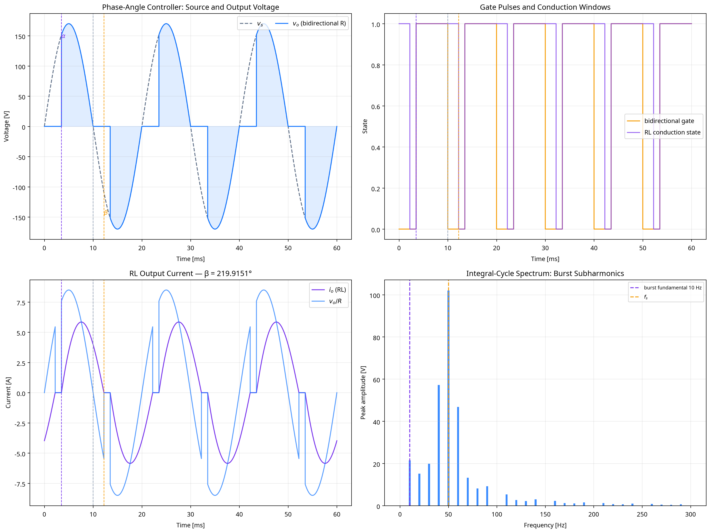
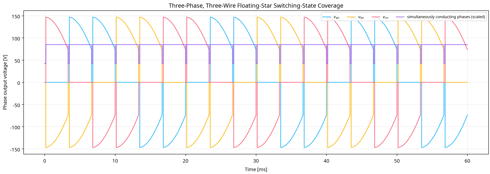

# AC Voltage Controller RMS, PF, Root-Solving, and Spectrum Verification Report

## Scope and tolerance contract

The laboratory uses $V_m=170.0\,\mathrm{V}$, $f_s=50.0\,\mathrm{Hz}$, $R=20.0\,\Omega$, $L=0.055\,\mathrm{H}$, and $\alpha=63.0254^\circ$. It validates ideal R-load unidirectional/bidirectional phase-angle RMS and integral-cycle RMS, together with the stated bidirectional RL conduction-angle RMS relation. The strict $0.0001\%$ allowance is enforced by increasing the timebase until every numerical RMS and resistive-power consistency comparison passes.

| Benchmark | Samples/source cycle | $V_{rms}$ numerical [V] | $V_{rms}$ analytical [V] | RMS error | $P$ consistency error | PF |
|---|---:|---:|---:|---:|---:|---:|
| unidirectional_R_phase_angle | 1075200 | 113.357452538 | 113.357477558 | 2.2071797e-05% | 1.7694571e-14% | 0.9430097 |
| bidirectional_R_phase_angle | 1075200 | 106.065187936 | 106.065241416 | 5.0422217e-05% | 2.0211309e-14% | 0.8823460 |
| integral_cycle_R | 1075200 | 93.112834776 | 93.112834776 | 0% | 2.6225337e-14% | 0.7745967 |
| bidirectional_RL_phase_angle | 1075200 | 110.410420374 | 110.410494225 | 6.6887581e-05% | 1.0382577e-11% | 0.6502580 |

The RL root solver gives $\beta=219.9151420433^\circ$ and $\gamma=\beta-\alpha=156.8897845789^\circ$; its transcendental current residual is below $10^{-12}$. A compact Radau solve is also executed as an independent stiff-ODE reference for the RL branch.

## Integral-cycle control and spectrum

The burst uses $n=3$ ON cycles and $m=2$ OFF cycles, giving $k=0.6000$ and $f_b=f_s/(n+m)=10.0000\,\mathrm{Hz}$. The FFT is evaluated over one integer burst period, so components below $f_s$ are resolved rather than aliased into a source-period spectrum.

## Three-phase coverage boundary

The three-phase case is a resistive, no-neutral floating-star switching-state coverage model. It applies phase gates, forms the instantaneous floating neutral from active phases, and shows zero intervals and active-phase count. Full analytic three-phase RMS/commutation validation requires further specification of source impedance, exact firing-sequence regime, and load connection; this laboratory does not claim a single formula for all such states.

## Figures

## References

1. [Monolithic Power Systems, *Single-Phase AC/AC Converters*](https://www.monolithicpower.com/en/learning/mpscholar/power-electronics/ac-ac-converters/single-phase-ac-ac-converters).
2. [Monolithic Power Systems, *Three-Phase AC/AC Converters*](https://www.monolithicpower.com/en/learning/mpscholar/power-electronics/ac-ac-converters/three-phase-ac-ac-converters).
