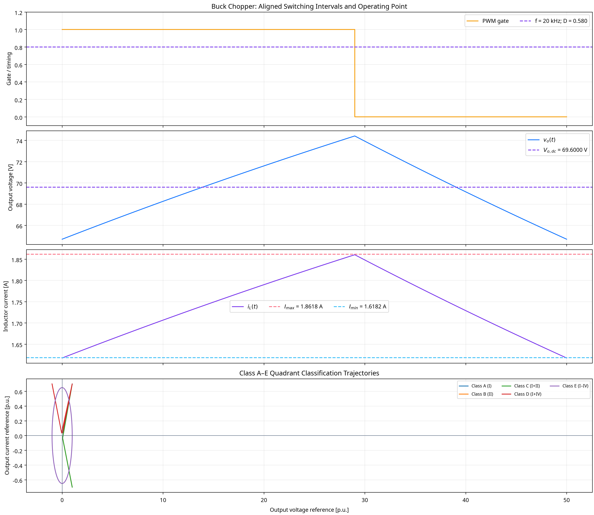
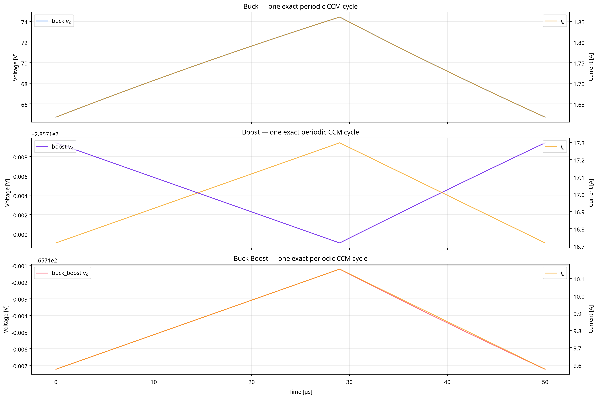

# DC–DC Chopper Switching-State Verification Report

## Scope and exactness contract

The laboratory uses $V_s=120.0\,\mathrm{V}$, $D=0.58$, $f=20.0\,\mathrm{kHz}$, $R=40.0\,\Omega$, $L=0.006\,\mathrm{H}$, and $C=0.02\,\mathrm{F}$. Buck, Boost, and inverting Buck-Boost CCM trajectories are generated by exact periodic affine state transitions for each ON/OFF interval. The strict $0.0001\%$ test applies to the ideal CCM conversion ratios and the Buck ripple relation. The resolution begins at $T/2016$ and refines automatically when required.

| Exact CCM benchmark | $V_{o,dc}$ simulated [V] | $V_{o,dc}$ analytical [V] | Conversion error | $\Delta I$ simulated [A] | $\Delta I$ analytical [A] | Ripple error |
|---|---:|---:|---:|---:|---:|---:|
| buck_CCM_R | 69.600000 | 69.600000 | 4.0835789e-14% | 0.2436000 | 0.2436 | 1.1393914e-13% |
| boost_CCM_R | 285.714256 | 285.714286 | 1.0313196e-05% | 0.5795000 | N/A | N/A |
| buck_boost_CCM_R | -165.714256 | -165.714286 | 1.7773442e-05% | 0.5795000 | N/A | N/A |

The ideal analytical gains are $DV_s$, $V_s/(1-D)$, and $-DV_s/(1-D)$ for Buck, Boost, and Buck-Boost, respectively. The inverting sign of Buck-Boost is retained in every reported output-voltage metric.

## Continuity, RLE, and quadrant coverage

The script applies the supplied critical-inductance formulas. Low-inductance cases use $L=0.3L_c$ and are reported as DCM-expected switching coverage. RLE examples and Class A/B operation are state-space coverage models. The Class C–E plots are quadrant-classification trajectories; exact Class E bridge switching requires device/dead-time/modulation assumptions outside the stated ideal inputs.

| Coverage case | Topology | Expected class | $V_{o,dc}$ [V] | $I_{o,dc}$ [A] | $L_c$ [H] |
|---|---|---|---:|---:|---:|
| buck_low_L_coverage | buck | DCM expected | 69.59868 | 1.73997 | 0.00042 |
| boost_low_L_coverage | boost | DCM expected | 285.70853 | 7.14271 | 0.000102312 |
| buck_boost_low_L_coverage | buck_boost | DCM expected | -165.71095 | -4.14277 | 0.0001764 |
| Class_A_RLE_coverage | buck | I | 69.60148 | 1.14004 | 0.00042 |
| Class_B_RLE_coverage | buck | II | 50.37798 | -0.65945 | 0.00042 |

## PWM and frequency modulation

For PWM, $T=1/f$ and $D=T_{on}/T$. The utility also evaluates constant-$T_{on}$ and constant-$T_{off}$ frequency modulation, calculating the equivalent $D=T_{on}f$ from each timing set. The figure uses the PWM case, where $T_{on}=29.0000\,\mu\mathrm{s}$ and $T_{off}=21.0000\,\mu\mathrm{s}$.

## Figures

## Reference

1. [Monolithic Power Systems, *Buck Converters (Step-Down Converter)*](https://www.monolithicpower.com/en/learning/mpscholar/power-electronics/dc-dc-converters/buck-converters).
