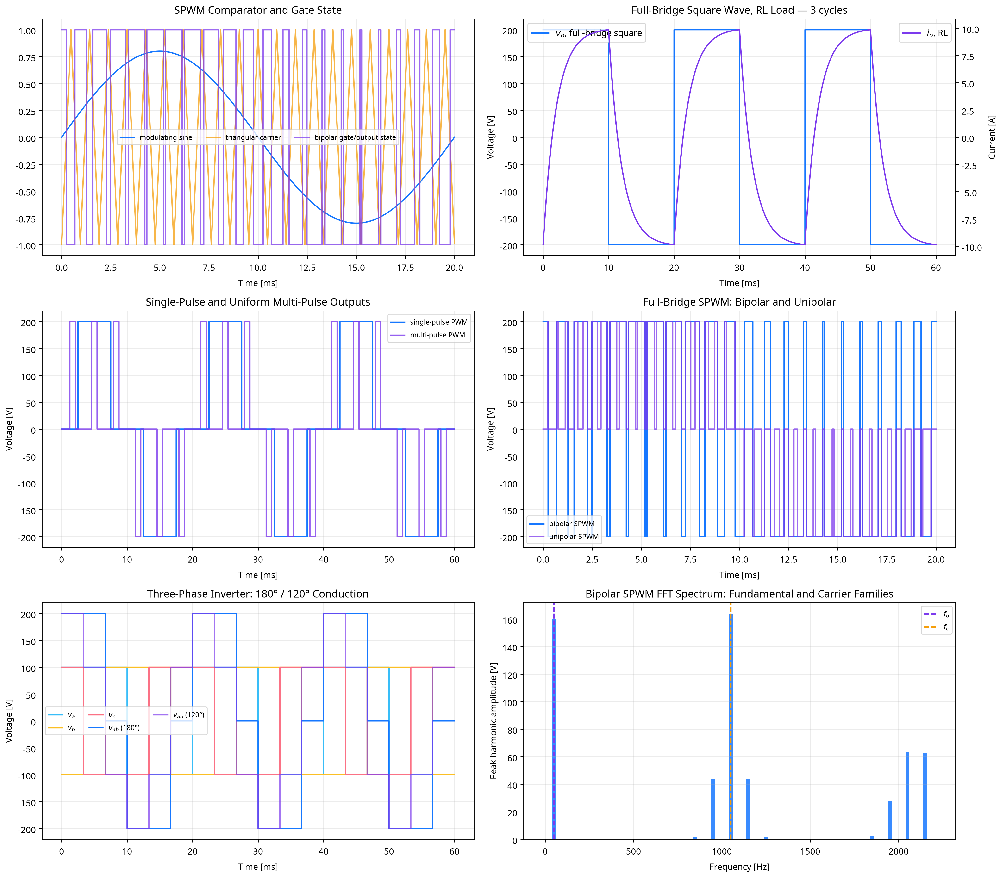

# DC–AC Inverter Fourier/FFT Verification Report

## Scope and tolerance contract

This laboratory uses $V_{dc}=200.0\,\mathrm{V}$, $f_o=50.0\,\mathrm{Hz}$, $R=20.0\,\Omega$, $L=0.04\,\mathrm{H}$, $E=25.0\,\mathrm{V}$, $m_a=0.8$, and $m_f=21$. The strict $0.0001\%$ threshold is applied to fully specified ideal switching benchmarks: half-/full-bridge square-wave total and fundamental RMS, full-bridge single-pulse RMS/fundamental, three-phase 180°/120° line-voltage RMS/fundamental, and the linear-region bipolar-SPWM fundamental. The script requires a 10× safety margin for the non-carrier benchmarks and directly refines the SPWM comparator timebase until the requested threshold is met.

| Exact benchmark | Samples/fundamental period | Total RMS FFT error | Fundamental RMS FFT error |
|---|---:|---:|---:|
| half_bridge_square | 67200 | 0% | 3.6425882e-08% |
| full_bridge_square | 67200 | 0% | 3.6425882e-08% |
| single_pulse_full_bridge | 67200 | 0% | 3.6425892e-08% |
| three_phase_180_line | 67200 | 1.7404671e-14% | 3.6425867e-08% |
| three_phase_120_line | 67200 | 2.0097183e-14% | 3.6425892e-08% |
| bipolar_spwm_linear | 4300800 | N/A | 4.4988762e-05% |

## Switching, load, and FFT coverage

The laboratory creates square, single-pulse, multi-pulse, bipolar-SPWM, unipolar-SPWM, and three-phase 180°/120° waveforms. It uses a compact stiff Radau reference solve plus the exact zero-order-hold interval solution of the RL/RLE ODE for high-resolution switching datasets, and a direct R relationship for the resistive case. RLE is treated as a converged switching/freewheel approximation, rather than assigned a nonexistent general finite Fourier equality. The FFT is bin-synchronous over one fundamental period, avoiding spectral leakage in the reported harmonic factors.

| Waveform | Load | $V_{rms}$ [V] | $V_{1,rms}$ [V] | $I_{1,rms}$ [A] | $THD_v$ | $THD_i$ | PF |
|---|---|---:|---:|---:|---:|---:|---:|
| square | R | 200.00000 | 180.06326 | 9.00316 | 0.48343 | 0.48343 | 1.00000 |
| square | RL | 200.00000 | 180.06326 | 7.62328 | 0.48343 | 0.20411 | 0.77830 |
| square | RLE | 200.00000 | 180.06326 | 6.73922 | 0.48343 | 0.22333 | 0.80789 |
| single_pulse | R | 141.39329 | 127.28427 | 6.36421 | 0.48371 | 0.48371 | 1.00000 |
| single_pulse | RL | 141.39329 | 127.28427 | 5.38879 | 0.48371 | 0.20430 | 0.77824 |
| single_pulse | RLE | 141.39329 | 127.28427 | 4.66121 | 0.48371 | 0.22543 | 0.81939 |
| multi_pulse | R | 100.03967 | 47.03816 | 2.35191 | 1.87701 | 1.87701 | 1.00000 |
| multi_pulse | RL | 100.03967 | 47.03816 | 1.99144 | 1.87701 | 0.51718 | 0.44911 |
| multi_pulse | RLE | 100.03967 | 47.03816 | 1.17637 | 1.87701 | 0.85711 | 0.51656 |
| spwm_bipolar | R | 200.00000 | 113.11227 | 5.65561 | 1.45821 | 1.45821 | 1.00000 |
| spwm_bipolar | RL | 200.00000 | 113.11227 | 4.78879 | 1.45821 | 0.10277 | 0.48219 |
| spwm_bipolar | RLE | 200.00000 | 113.11227 | 3.94025 | 1.45821 | 0.13180 | 0.50965 |
| spwm_unipolar | R | 142.78967 | 113.11227 | 5.65561 | 0.77044 | 0.77044 | 1.00000 |
| spwm_unipolar | RL | 142.78967 | 113.11227 | 4.78879 | 0.77044 | 0.02842 | 0.67142 |
| spwm_unipolar | RLE | 142.78967 | 113.11227 | 3.91766 | 0.77044 | 0.06046 | 0.70562 |

The $HF_n$ values for $n=3,5,7,9,11$, distortion factor, and active power are stored in the machine-readable summary. The selected RL cases demonstrate high-frequency attenuation in current relative to voltage; this is a model result for the stated $R$ and $L$, not an unrestricted theorem for every possible load.

## Three-phase convention

For the 180° VSI, the line voltage is generated from the difference of phase pole voltages. The benchmark reproduces $V_{LL,rms}=V_{dc}\sqrt{2/3}$, while the phase-to-neutral total RMS is $V_{dc}\sqrt2/3$. For 120° operation, the line RMS benchmark is $V_{dc}/\sqrt2$. The harmonic series and fundamental relation follow the 180° Virtual Labs convention.[1]

## Figure

## References

1. [IIT Roorkee Virtual Labs, *Three Phase VSI with 120° and 180° Conduction Mode*](https://pe-iitr.vlabs.ac.in/exp/three-phase-conduction/theory.html).
2. [Monolithic Power Systems, *Pulse Width Modulation (PWM) Techniques*](https://www.monolithicpower.com/en/learning/mpscholar/power-electronics/dc-ac-converters/pulse-width-modulation-techniques).
