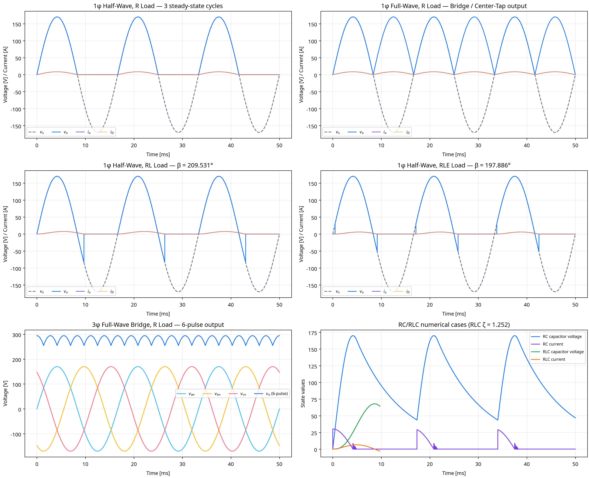

# Uncontrolled Rectifier Numerical Verification Report

## Scope and tolerance contract

This laboratory uses $V_m=170.0\,\mathrm{V}$, $f=60.0\,\mathrm{Hz}$, $R=20.0\,\Omega$, $L=0.03\,\mathrm{H}$, $C=0.00047\,\mathrm{F}$, and $E=30.0\,\mathrm{V}$. It presents three steady-state cycles for waveform cases. The strict $0.0001\%$ criterion is applied only where an exact ideal-diode analytical benchmark is available and unambiguous: the R-load voltage averages and RMS values. RL/RLE extinction angles are checked by their root residuals; RC/RLC models are converged numerical switching cases, not falsely claimed as a single universal analytical equality.

| Exact benchmark | Points/cycle after adaptive convergence | $V_{dc}$ simulation | $V_{dc}$ analytical | $V_{dc}$ error | $V_{rms}$ error |
|---|---:|---:|---:|---:|---:|
| 1phi_half_R | 2097152 | 54.112689252 | 54.112680651 | 1.5894574e-05% | 7.9472869e-06% |
| 1phi_full_R | 2097152 | 108.225378504 | 108.225361302 | 1.5894574e-05% | 7.9472869e-06% |
| 3phi_half_R | 262144 | 140.588859896 | 140.588868333 | 6.0012206e-06% | 3.8907206e-06% |
| 3phi_full_R | 262144 | 281.177719791 | 281.177736665 | 6.0012206e-06% | 6.0202964e-06% |

The independent bisection solves give $\beta_{RL}=209.531404205^\circ$ and $\beta_{RLE}=197.885910128^\circ$. The defining current equations are evaluated at each root with an absolute residual below $10^{-12}$.

## General numerical-load coverage

The matrix below runs each requested non-pure-R load under the four source/topology selections for three settled cycles. These are **converged numerical coverage cases**, rather than false analytical-equality claims, because RC/RLC diode turn-on and turn-off depend on state history and because general three-phase RL/RLE commutation requires additional source-impedance assumptions. The laboratory assumes $L_s=0$ as requested.

| Source/topology selection | Load | $V_{dc}$ numerical [V] | $V_{rms}$ numerical [V] | $I_{dc}$ numerical [A] |
|---|---|---:|---:|---:|
| 1phi_half | RL | 54.113357 | 85.000531 | 2.705668 |
| 1phi_half | RLE | 67.125041 | 87.290742 | 1.856250 |
| 1phi_half | RC | 101.257223 | 108.790786 | 3.622730 |
| 1phi_half | RLC | 112.459646 | 112.701352 | 0.508159 |
| 1phi_full | RL | 108.226714 | 120.208904 | 5.411290 |
| 1phi_full | RLE | 108.226714 | 120.208904 | 3.911290 |
| 1phi_full | RC | 135.818385 | 137.819805 | 4.291675 |
| 1phi_full | RLC | 135.692771 | 135.764886 | 0.371156 |
| 3phi_half | RL | 140.588785 | 142.916099 | 7.029434 |
| 3phi_half | RLE | 140.588785 | 142.916099 | 5.529434 |
| 3phi_half | RC | 149.499549 | 150.273328 | 4.245578 |
| 3phi_half | RLC | 148.401675 | 148.424152 | 0.256171 |
| 3phi_full | RL | 281.177571 | 281.425066 | 14.058886 |
| 3phi_full | RLE | 281.177571 | 281.425066 | 12.558886 |
| 3phi_full | RC | 282.093839 | 282.286209 | 6.223339 |
| 3phi_full | RLC | 280.072656 | 280.077666 | 0.169277 |

## Topology distinctions

The single-phase full-wave **bridge** and **center-tapped** versions create the same ideal $|V_m\sin\omega t|$ load-voltage waveform for the reference source, but their diode PIV differs: $V_m$ for a bridge diode and $2V_m$ for a center-tapped diode. Three-phase half-wave output is the maximum positive line-to-neutral phase. Three-phase full-wave output is the instantaneous maximum line-to-neutral phase minus the instantaneous minimum phase, producing the six-pulse output.

## Numerical methods

The RL and RLE conduction segments use `solve_ivp` with the stiff Radau method, $rtol=10^{-10}$, and $atol=10^{-12}$. The half-wave RL/RLE extinction angle is solved by bracketed root finding. The RC envelope applies the ideal-diode charge condition and exponential load discharge. The RLC section uses BDF integration of the requested second-order state model and reports damping ratio $\zeta=R\sqrt{C/L}/2$. Zero source inductance is assumed for the three-phase commutation model.

## Figure

## References

1. [IIT Roorkee Virtual Labs, *Single Phase Half Wave Silicon Controlled Rectifier with R, RL & RLE Load*](https://pe-iitr.vlabs.ac.in/exp/single-half-silicon/theory.html). Its RL/RLE derivation supplies the sinusoidal-plus-exponential current construction and zero-current extinction condition; setting firing angle $\alpha=0$ gives the diode benchmark.
2. [Monolithic Power Systems, *Uncontrolled Rectifiers*](https://www.monolithicpower.com/en/learning/mpscholar/ac-power/ac-dc-power-conversion-techniques/uncontrolled-rectifiers).
