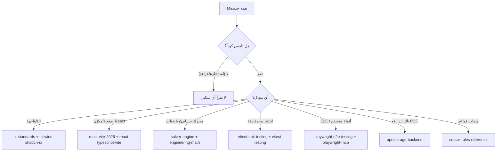

# 🧭 Skills Router — MAE Academy

**الغرض:** توجيه ذكي مختصر لأي وكيل برمجي (Copilot / Cursor / غيره) ليقرأ **السكيل المعنية فقط** عند الحاجة (On-Demand) بدلاً من قراءة كل السكيلز في كل محادثة.

**القاعدة الذهبية:** لا تقرأ أي سكيل إلا عند تطابق **شرط الاستدعاء** أدناه مع المهمة الحالية. إذا لم ينطبق أي شرط، **تجاهل كل السكيلز** وتابع بعلمك العام.

---

## 0. سياسة القراءة (اعمل بها دائماً)

| القاعدة | التوجيه |
| --- | --- |
| **القراءة عند الحاجة** | اقرأ ملف السكيل الواحد المطابق للمهمة فقط — وليس كل المجلد `.skills/`. |
| **أقل عدد ملفات** | إذا طابقت المهمة أكثر من سكيل، اقرأها معاً بطلب واحد، ولا تفتح ملفات خارج نطاق المهمة. |
| **لا للحفظ الكامل** | لا تدمج محتوى السكيلز في سياقك الدائم؛ استخدمها كمرجع لحظي ثم تخلَّ عنها. |
| **قبل كتابة/تعديل الكود فقط** | المهام الاستشارية أو القراءة العامة للمستودع **لا تستدعي** أي سكيل. |
| **ملفات السكيلز نفسها** | تعديل/إنشاء ملفات في `.skills/` أو `skills-router.md` يستدعي `cursor-rules-reference.md` فقط. |

> مسار الجذر: كل الملفات أدناه موجودة في `.skills/<file>`.

---

## 1. جدول الاستدعاء — سكيل واحد لكل مهمة

### A. الواجهة والتصميم (قراءة عند أي تعديل في `client/` للـ UI)

| السكيل | شرط الاستدعاء (اقرأ إذا…) | تجاهَل تماماً إذا… |
| --- | --- | --- |
| **`ui-standards.md`** | تعديل واجهة، ستايل، KaTeX، أو مكوّن مرئي جديد داخل `client/src` | المهمة منطق خالص أو باك إند بلا أي واجهة |
| **`tailwind-shadcn-ui.md`** | استخدام/إضافة فئات Tailwind أو مكوّنات shadcn/ui جديدة | لا لمس لـ Tailwind أو shadcn (منطق، بيانات، اختبارات) |

### B. React + TypeScript + Vite (📌 **مدمج**: اقرأ السكيلين معاً فقط عند الحاجة)

| السكيل | شرط الاستدعاء (اقرأ إذا…) |
| --- | --- |
| **`react-vite-2026.md`** + **`react-typescript-vite.md`** | بناء/تعديل صفحة، مكوّن React، Hook، توجيه، أو ملف `*.tsx`؛ أو تغيير إعدادات Vite/TypeScript/Build |

**تجاهَل السكيلين تماماً** إذا كانت المهمة عديمة العلاقة بـ React/TS/Vite (مثل: منطق باك إند، سكربت تحليل Python في `analysis/`، بيانات ثابتة).

> **إرشاد الدمج:** لا تفتح `react-*` عند كل مهمة في الواجهة؛ اقرأها **مرة واحدة لكل ميزة جديدة** تُنشئ بنية React من الصفر أو تغيّر العمارة — وليس لكل تعديل صغير في مكوّن قائم.

### C. المحركات الحسابية والرياضيات (Simulators)

| السكيل | شرط الاستدعاء (اقرأ إذا…) | تجاهَل تماماً إذا… |
| --- | --- | --- |
| **`solver-engine.md`** | بناء/تعديل محرك حسابي، محاكاة، أو منطق مفصول عن React | العمل في `analysis/` (سكربتات Python مستقلة) أو واجهة فقط |
| **`engineering-math.md`** | كتابة دوال رياضية، ضمان استقرار رقمي، حدود `O(N)`/أداء، أو تنسيق KaTeX للمخرجات | لا رياضيات حاسوبية في المهمة |

> **قراءة مشتركة:** أي مهمة في `analysis/*_verification.py` أو محركات `v3-simulator` قد تستدعي `solver-engine.md` + `engineering-math.md` + `vitest-testing.md` معاً.

### D. الاختبارات — وحدة (📌 **مدمج**: Vitest معاً)

| السكيل | شرط الاستدعاء (اقرأ إذا…) |
| --- | --- |
| **`vitest-unit-testing.md`** | كتابة/تعديل **اختبار وحدة** (`.test.ts` / `.spec.ts`) مع TypeScript |
| **`vitest-testing.md`** | كتابة/تعديل اختبارات المشروع، أو **معايير الدقة الرياضية** (خاصة لمحركات/محاكيات) |

**تجاهَل الاثنين** إذا كانت المهمة لا تكتب ولا تشغّل اختبارات Vitest (تعديل ميزة فقط، واجهة، باك إند).

> **إرشاد الدمج:** `vitest-unit-testing.md` = ميكانيكا كتابة الاختبارات؛ `vitest-testing.md` = معايير المشروع والدقة. اقرأ كليهما معاً عند **أول اختبار** ضمن مهمة، وليس عند كل اختبار لاحق.

### E. الاختبارات — E2E و Automation (📌 **مدمج**: Playwright معاً)

| السكيل | شرط الاستدعاء (اقرأ إذا…) |
| --- | --- |
| **`playwright-e2e-testing.md`** | كتابة/تشغيل اختبارات **End-to-End** عبر المتصفح أو السيلينيوم |
| **`playwright-mcp.md`** | أتمتة متصفح حيّة عبر **MCP/أدوات المتصفح** أثناء الجلسة الحالية (تصحيح/تحقق بصري) |

**تجاهَل الاثنين** إذا كانت المهمة لا تستخدم Playwright إطلاقاً.

> **إرشاد الدمج:** `playwright-e2e-testing.md` = اختبارات تُكتب في المستودع؛ `playwright-mcp.md` = تحقق لحظي تفاعلي. لا تفتح MCP إذا كنت تكتب فقط اختبار E2E في ملف، والعكس.

### F. إدارة ملفات السكيلز/القواعد نفسها

| السكيل | شرط الاستدعاء (اقرأ إذا…) |
| --- | --- |
| **`cursor-rules-reference.md`** | تعديل/إنشاء أي ملف قواعد: `.skills/*.md`، `skills-router.md`، `AGENTS.md`، `.cursorrules`، أو فهم صيغة الاستيراد/البنية |

**تجاهَل** إذا كانت المهمة لا تلمس ملفات القواعد.

---

## 2. سير عمل لوحة التحكم + باك إند رفع الـ PDF 📄

> **سياق الواقع:** حالياً `server/index.ts` يستضيف فقط بناء SPA ثابتاً — **لا يوجد بعد** مسار رفع/تصنيف للـ PDF. هذا القسم **خارطة طريق استرشادية** للميزة المخططة (رفع وتصنيف ملفات PDF ضمن فئتين: **Academic Research** / **Academic Courses**). عند تنفيذها، طابق السكيل التالي:

### السكيل المعني (اقرأ عند تنفيذ/مراجعة أي من خطوات الرفع)

| السكيل | شرط الاستدعاء |
| --- | --- |
| **`api-storage-backend.md`** | تنفيذ/تدقيق/تحسين: رفع PDF، تخزين خادم، طبقة API، مخططات بيانات وصفية (Metadata) لأصول Academic Research / Courses، أو تخزين محلي احتياطي (Local Filesystem Fallback) |

### خطوات السير الموصى بها (تتبّعها عند كل مهمة رفع)

1. **التوجيه:** اقرأ `api-storage-backend.md` أولاً (طبقة الـ API **لا** تقوم بـ IO مباشر — فوّض لخدمة/Repository).
2. **الاستقبال:** استخدم **Streaming** للملف بدل التحميل الكامل في الذاكرة (Piping للمولتي‌بارت).
3. **التصنيف:** حدّد الفئة عند الحفظ — `courses` مقابل `research` — في مسار/مخطط منفصل.
4. **الأمان:** عادّل أسماء الملفات وامنع Directory Traversal (تحقق أن المسار النهائي داخل الجذر).
5. **الـ Metadata:** عرّف مخططاً Typed للمستند (العنوان، الفئة، المقرر، الوسوم، حجم الملف، التاريخ…).
6. **التخزين:** وفّر مُهايئ `FileSystemStorage` محلياً للتطوير/الاختبار بجانب أي Cloud (Supabase/S3) لاحقاً.
7. **التحقق:** قبل اعتماد أي مسار، اكتب/شغّل اختبارات — Vitest للوحدة (فئة D) وPlaywright E2E لمجرى الرفع في الواجهة (فئة E).

> **لاحقاً فقط** عند إضافة واجهة الرفع: أضف `ui-standards.md` + `tailwind-shadcn-ui.md` (فئة A) و`react-*` (فئة B) للجانب المرئي للوحة التحكم.

---

## 3. ملخص سريع — خريطة قرار

**تذكير أخير:** اقرأ **أقل عدد ممكن** من السكيلز، عند الحاجة فقط، وبطلب واحد مجمّع — لتحمي التوكنز وتمنع Context Dilution.
