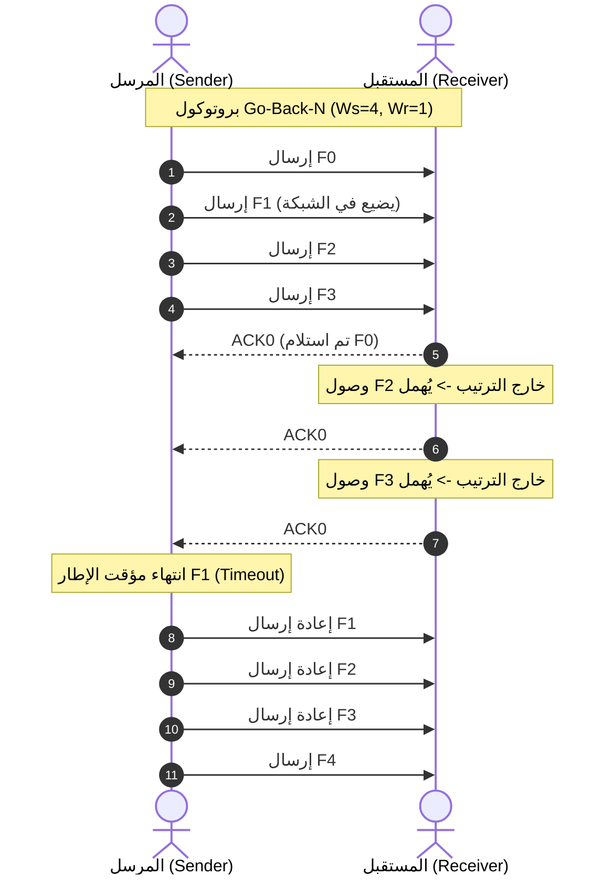
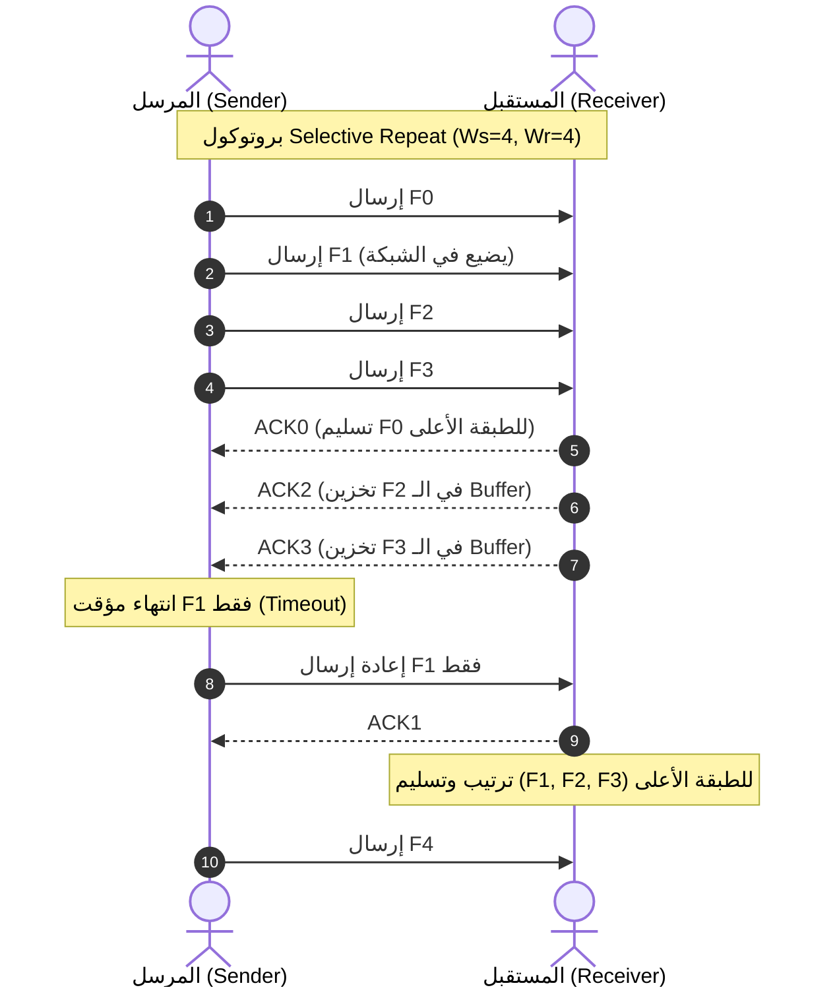

You are an independent external professor and examiner grading an AI teaching assistant's answer. Grade rigorously: re-derive every number and formula yourself before trusting the answer.

Score out of 100:
- accuracy (0-40): every intermediate algebraic step, numerical result and formula is correct; no sign inversions or dropped terms. Re-compute numbers.
- formatting (0-20): standard LaTeX ($inline$ and $$display$$), no unparsed dollar strings, SI units with proper prefixes.
- pedagogy (0-20): clear physical rationale, governing laws identified, structural rigor.
- sanity (0-20): dimensional homogeneity, limiting cases and physical realizability checked.
AUTOMATIC FAIL (final score 0, set auto_fail=true and say why): hallucinated physical equations or unphysical results; skipping algebra on an advanced or elite derivation request; broken LaTeX that fails KaTeX parsing (an objective KaTeX report is provided).
Do not reward length. Penalise any confident wrong claim more than an honest "cannot verify". If the question itself contains a flawed premise, credit the answer for catching it.

Reply with ONE JSON object and nothing else:
{"score": number, "breakdown": {"accuracy": n, "formatting": n, "pedagogy": n, "sanity": n}, "auto_fail": boolean, "auto_fail_reason": string, "errors": [string, ...], "summary": string}
"errors" lists every concrete mistake or gap (quote the line and give the correct value); [] if none.

=== DISCIPLINE / TIER ===
Telecom, Optical & Networks / easy

=== QUESTION ===
في شبكات الحاسوب، ما هو الفرق بين بروتوكول Go-Back-N و Selective Repeat من حيث حجم نافذة الإرسال والاستقبال ($W_s, W_r$)، مع ذكر سيناريو ضياع الإطار الثاني في رسالة من 5 إطارات.

=== OBJECTIVE LATEX REPORT ===
KaTeX parse check: all 69 math spans parse cleanly.

=== ANSWER UNDER REVIEW ===
يعتمد بروتوكولا **Go-Back-N (GBN)** و **Selective Repeat (SR)** على مبدأ النوافذ المنزلقة (Sliding Window) للتحكم في التدفق والخطأ (ARQ) في طبقة ربط البيانات (Data Link Layer) أو طبقة النقل (Transport Layer مثل TCP).

---

### 1. حجم نافذة الإرسال والاستقبال ($W_s, W_r$)

إذا كان رقم التسلسل (Sequence Number) يُمثَّل بعدد $m$ من الخانات الثنائية (Bits)، فإن فضاء أرقام التسلسل الكلي يكون $N = 2^m$.

#### أ. بروتوكول Go-Back-N (GBN)
* **نافذة الإرسال ($W_s$):**
  $$1 < W_s \le 2^m - 1$$
  الشرط الرياضي الحاكم هو $W_s < 2^m$. فإذا كان $W_s = 2^m$، وضاعت جميع إشعارات الاستلام ($\text{ACKs}$)، فلن يتمكن المستقبل من التمييز بين إعادة إرسال الإطارات القديمة أو وصول إطارات من دورة تسلسل جديدة.
* **نافذة الاستقبال ($W_r$):**
  $$W_r = 1$$
  المستقبل لا يقبل إلا الإطار التالي بالترتيب الدقيق ($R_{next}$). أي إطار يصل خارج الترتيب يُهمل مباشرة (Discarded) حتى وإن كان سليماً، ويُرسل إشعار تأكيد تراكمي ($\text{Cumulative ACK}$) لآخر إطار تم استلامه بنجاح وبشكل متسلسل.

---

#### ب. بروتوكول Selective Repeat (SR)
* **نافذة الإرسال ($W_s$) ونافذة الاستقبال ($W_r$):**
  يشترط البروتوكول لمنع تداخل النافذة الحالية مع النافذة التالية الشرط التالي:
  $$W_s + W_r \le 2^m$$
  وفي الحالة القياسية المتناظرة ($W_s = W_r$):
  $$W_s \le 2^{m-1}, \quad W_r \le 2^{m-1}$$
* **سلوك الاستقبال:**
  المستقبل يمتلك ذاكرة وسيطة (Buffer) بحجم $W_r$. يستقبل الإطارات التي تقع ضمن مجال نافذته حتى لو وصلته خارج الترتيب، ويخزنها ويرسل إشعار تأكيد فردي ($\text{Individual / Selective ACK}$) لكل إطار سليم، ولا يمررها للطبقة الأعلى إلا بعد اكتمال الترتيب المتسلسل.

---

### 2. جدول المقارنة الهندسية

| المعيار | Go-Back-N (GBN) | Selective Repeat (SR) |
| :--- | :--- | :--- |
| **حجم نافذة الإرسال ($W_s$)** | $W_s \le 2^m - 1$ | $W_s \le 2^{m-1}$ |
| **حجم نافذة الاستقبال ($W_r$)** | $W_r = 1$ | $W_r \le 2^{m-1}$ |
| **نوع إشعار الاستلام (ACK)** | تراكمي (Cumulative) | فردي / انتقائي (Individual / Selective) |
| **ذاكرة التخزين عند المستقبل** | لا يحتاج إلى Buffer للإطارات غير المتسلسلة | يتطلب Buffer بحجم $W_r$ |
| **إعادة الإرسال عند الخطأ** | يُعيد إرسال الإطار التالف وكل ما تلاه في النافذة | يُعيد فقط الإطار التالف الذي انتهى مؤقته |
| **المؤقتات (Timers)** | مؤقت واحد لأقدم إطار غير مؤكد | مؤقت مستقل لكل إطار مرسل |

---

### 3. سيناريو ضياع الإطار الثاني في رسالة من 5 إطارات

* **الرسالة:** 5 إطارات مرتبة: $\{F_0, F_1, F_2, F_3, F_4\}$ (الإطار الثاني هو $F_1$).
* **حجم نافذة الإرسال:** نَفترض $W_s = 4$.

#### السيناريو تحت بروتوكول GBN:
1. يُرسل المرسل الإطارات الأربعة الأولى ضمن نافذته: $F_0, F_1, F_2, F_3$.
2. يستلم المستقبل $F_0$ بنجاح، ويرسل $\text{ACK}_0$ (أو يطلب الإطار القادم $\text{ACK}_1$)، وتنزاح نافذة المستقبل للموقع $1$.
3. **يضيع الإطار $F_1$ في القناة.**
4. يصل الإطاران $F_2$ و $F_3$ إلى المستقبل:
   - بما أن $W_r = 1$ وينتظر $F_1$ حصراً، يُهمل المستقبل كلاً من $F_2$ و $F_3$ فوراً.
   - يعيد المستقبل إرسال إشعار $\text{ACK}_0$ عند وصول كل إطار خاطئ للتأكيد على أنه ما زال ينتظر $F_1$.
5. ينتهي مؤقت الإطار $F_1$ (Timeout) عند المرسل.
6. **سلوك الإعادة:** يرجع المرسل للخلف ويعيد إرسال جميع الإطارات التي انطلقت من $F_1$ فصاعداً: يعيد إرسال $F_1, F_2, F_3, F_4$.

---

#### السيناريو تحت بروتوكول Selective Repeat (SR):
1. يُرسل المرسل الإطارات: $F_0, F_1, F_2, F_3$.
2. يستلم المستقبل $F_0$ ويرسل $\text{ACK}_0$ الفردي، ويسلم $F_0$ للطبقة الأعلى وتنزاح نافذته لاستقبال $F_1$.
3. **يضيع الإطار $F_1$ في القناة.**
4. يصل الإطاران $F_2$ و $F_3$ إلى المستقبل:
   - بما أن $F_2$ و $F_3$ يقعان ضمن نافذة الاستقبال ($W_r = 4$)، يخزنهما المستقبل في الذاكرة المؤقتة (Buffer).
   - يرسل المستقبل إشعارات فردية: $\text{ACK}_2$ و $\text{ACK}_3$.
   - لا تنزاح نافذة الاستقبال لأنها محجوزة بانتظار $F_1$ (أدنى رقم تسلسلي لم يستلم بعد).
5. يستلم المرسل $\text{ACK}_2$ و $\text{ACK}_3$ ويوقف مؤقتيهما ويوثق استلامهما، لكن نافذة الإرسال لا تنزاح لأن $F_1$ لم يُؤكد بعد.
6. ينتهي مؤقت $F_1$ فقط لدى المرسل.
7. **سلوك الإعادة:** يُعيد المرسل **فقط** الإطار $F_1$.
8. يستلم المستقبل الإطار $F_1$، ويرسل $\text{ACK}_1$.
9. تكتمل الحزمة المتسلسلة $\{F_1, F_2, F_3\}$ في ذاكرة المستقبل، فيقوم بتمريرها دفعة واحدة بالترتيب السليم للطبقة الأعلى، وتنزاح نافذة الاستقبال إلى $F_4$.

